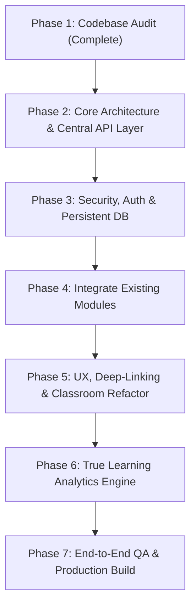

# LEARNOVA — Complete Codebase Audit & Implementation Map

**Audit Date:** November 2026  
**Auditor:** Senior Product Engineer & Software Architect  
**Repository:** [https://github.com/Mahe243/lms](https://github.com/Mahe243/lms)  
**Live Application:** [https://lms-yrpn.vercel.app/](https://lms-yrpn.vercel.app/)

---

## Executive Summary

Learnova is conceived as an **Editorial Intellect Personal Learning Operating System** combining deep academic rigor, quantitative finance, and distributed systems engineering with modern cognitive science (FSRS spaced repetition, hybrid lexical-semantic RAG, deliberate focus tracking, and Socratic AI tutoring).

The codebase possesses an **exceptionally rich, robust FastAPI backend** (109 REST endpoints, 25 SQLAlchemy models, FSRS algorithm, automated RAG pipeline, activity heartbeat deduplication, and full database export/import). However, the **frontend was operating almost entirely in isolation**, storing data in client-side state, mock datasets, and `localStorage`.

This audit documents the exact state of both systems, identifies security and persistence vulnerabilities, and establishes the blueprint to turn the backend into the authoritative source of truth.

---

## 1. Existing Functionality Matrix

| Module | Frontend Implementation | Backend Implementation | State / Source of Truth | Status |
| :--- | :--- | :--- | :--- | :--- |
| **Authentication & Profile** | `AppContext` (`initialUser`) | `/api/user/me` (`GET`, `PUT`) | Client `localStorage` | Disconnected |
| **Course Catalog** | `HomeDashboard.tsx`, `mockData.ts` | `/api/courses` (14 endpoints) | Hardcoded array in frontend | Disconnected |
| **Classroom (Video Player)** | `ClassroomView.tsx` (HTML5 + YouTube) | `/api/resources`, `/api/courses/topics` | Local component state | Disconnected |
| **Classroom (Notes)** | `ClassroomView.tsx` (Active Notebook) | `/api/notes` (7 endpoints) | `localStorage.getItem('learnova_notes_...')` | Disconnected |
| **Classroom (Quiz)** | `ClassroomView.tsx` (Knowledge Check) | `/api/quizzes/submit` | Local component state | Disconnected |
| **AI Tutor (Professor Nova)** | `AITutorView.tsx`, `StudyBotWidget.tsx` | `/api/ai/chat`, `/api/ai/conversations` | Direct browser API calls + mock | Disconnected & Insecure |
| **Flashcards (SRS)** | `LibraryView.tsx` (SRS Tab) | `/api/flashcards` (8 endpoints, FSRS) | `localStorage` (`learnova_state_v1_flashcards`) | Disconnected |
| **Resource Vault (Library)** | `LibraryView.tsx`, `UploadModal.tsx` | `/api/resources` (8 endpoints) | `localStorage` (`learnova_state_v1_library`) | Partially connected |
| **Focus Timer (Study Room)** | `StudyRoomView.tsx`, `soundscapes.ts` | `/api/study-sessions` (4 endpoints) | Client `setInterval` | Disconnected |
| **Tasks & Sprint Backlog** | `StudyRoomView.tsx` (Sprint checklist) | `/api/tasks` (4 endpoints) | React `useState` | Disconnected |
| **Practice Arena** | `PracticeArenaView.tsx` | `/api/quizzes/banks`, `/api/quizzes/questions` | Hardcoded `mockExamData` | Disconnected |
| **Projects & Capstone** | `ProjectsView.tsx` | Notes / Active Learning | Hardcoded `sampleProject` | Disconnected |
| **Goals & Analytics** | `GoalsProgressView.tsx` | `/api/activity/analytics`, `/api/goals` | Hardcoded UI percentages | Disconnected |
| **Database Backup / Restore** | None in UI | `/api/backup/export`, `/api/backup/restore` | Backend ready, no frontend trigger | Disconnected |

---

## 2. Frontend-Only Functionality

The following features exist only in the React/Vite layer and do not communicate with the server:

1. **Course & Lesson Switching**: Handled entirely inside `AppContext.tsx` (`courseLessonsMap[activeCourseId]`).
2. **Classroom Theory & Trade-Off Matrix**: Rendered from `Lesson.markdownContent` and hardcoded HTML tables in `ClassroomView.tsx`.
3. **Python In-Browser Simulation**: A simulated setTimeout block in `ClassroomView.tsx` and `ProjectsView.tsx` that mimics credit risk execution without running real code.
4. **Soundscape Engine**: Web Audio synthesizer in `src/utils/soundscapes.ts` (Binaural Alpha, White Noise, Deep Om, Rain) runs entirely client-side.
5. **Command Palette & Quick Recall**: Modal in `CommandPalette.tsx` that navigates between routes and logs thoughts into `learnova_state_v1_recalls`.
6. **Upload Dialog Preview**: Local object URL generation via `URL.createObjectURL(file)` allows local playback without uploading to durable storage.

---

## 3. Backend Functionality (Currently Underutilized)

The backend in `backend/` has extensive, tested logic that is currently dormant from the UI's perspective:

1. **Spaced Repetition Engine (`backend/services/fsrs.py`)**:
   - Modified SM-2 / FSRS algorithm with stability, difficulty, lapses, repetition counts, and interval calculation.
   - Undo review endpoint (`POST /api/flashcards/undo-review/{card_id}`).
2. **Contextual RAG Retrieval (`backend/services/rag.py` & `ai_service.py`)**:
   - Chunks text from uploaded PDFs and notes.
   - Performs TF-IDF and keyword matching over learner materials.
   - Builds grounded system prompts with exact source citations (page numbers, timestamps, and excerpt quotes).
3. **Activity Deduplication & Heartbeat (`backend/services/activity_service.py`)**:
   - `POST /api/activity/heartbeat`: Automatically calculates active study intervals with idle timeout detection.
   - Prevents artificial streak and XP inflation by enforcing deliberate learning actions and rate limiting.
4. **Quiz Engine & Mistake Log (`backend/routers/quizzes.py`)**:
   - Tracks question banks, individual question performance, multiple attempt histories, and generates mistake logs for targeted revision.
5. **Topic Revision Queue (`backend/routers/revision.py`)**:
   - Spaced revision queue for master course topics based on decay curves.
6. **Full Database Serialization & Restoration (`backend/routers/backup.py`)**:
   - Exports all database tables to encrypted/compressed JSON, notes to Markdown archives, and activity events to CSV.

---

## 4. API Integrations That Already Work

- `POST /api/resources/upload`: Tested in `UploadModal.tsx`; uploads multipart files to `UPLOAD_DIR` and creates `Resource` records.
- `GET /api/courses`: Returns populated course list and modules.
- `GET /api/activity/streak`: Correctly evaluates study streak days based on UTC timestamps.
- `GET /health`: Verified on local server and Vercel serverless function (`api/index.py`).

---

## 5. Features Using Mock Data or LocalStorage

| Data Item | LocalStorage Key | Risk / Limitation |
| :--- | :--- | :--- |
| User Profile & XP | `learnova_state_v1_user` | Lost on cache clear; no multi-device sync |
| Flashcards & Reps | `learnova_state_v1_flashcards` | FSRS algorithm bypassed; review stats lost |
| Resource Vault | `learnova_state_v1_library` | Uploaded files lost when closing browser |
| Classroom Notes | `learnova_notes_<lesson_id>` | Not indexed for RAG; not backed up |
| Gemini API Key | `learnova_state_v1_gemini_key` | Exposed in browser inspection; security flaw |
| Fast Recall Log | `learnova_state_v1_recalls` | Not connected to notes or spaced revision |
| Thought Parker Notes | `learnova_state_v1_thought_notes` | Local to single machine |

---

## 6. Security and Persistence Issues

1. **Client-Exposed AI Credentials**: The Gemini API key was stored in plain text in browser `localStorage` and sent directly in client-side `fetch` headers to Google Generative Language APIs.
2. **Unauthenticated Destructive Endpoints**: `POST /api/backup/clean-demo`, `DELETE /api/resources/{id}`, and `DELETE /api/courses/{id}` have no bearer token, password, or session protection.
3. **Permissive CORS**: `main.py` configured with `allow_origins=["*"]`, allowing arbitrary origins to read study records.
4. **Serverless Ephemeral Storage**: On Vercel, SQLite in `/tmp/lms.db` is ephemeral and gets destroyed between cold starts unless connected to a persistent PostgreSQL instance via `DATABASE_URL`.
5. **Schema Drift**: No Alembic migration tracking; schema changes rely on raw `Base.metadata.create_all()`.

---

## 7. Duplicate or Unnecessary Logic

- **Course Lessons Duplication**: `mockData.ts` contained 500+ lines of duplicated `courseLessonsMap` records.
- **Dual AI Implementations**: `AITutorView.tsx`, `StudyBotWidget.tsx`, and `backend/services/ai_service.py` each had separate prompt builders and response generation logic.
- **Dual Quiz Grading**: `ClassroomView.tsx` had client-side quiz scoring while `backend/routers/quizzes.py` had a server-side scoring and explanation engine.
- **Monolithic Component**: `ClassroomView.tsx` grew to 1,267 lines, combining video rendering, tab routing, markdown parsing, custom quiz evaluation, syllabus navigation, and notes saving into a single file.

---

## 8. Implementation Roadmap (Phases 2 – 7)

1. **Central API Client**: Build `frontend/src/api/` with axios/fetch wrapper, typed request/response handlers, auth header injection, error normalization, and offline state handling.
2. **Security Hardening**: Move AI calls strictly to `/api/ai/chat` using server-side keys; implement auth protection on backend; restrict CORS.
3. **Database as Single Source of Truth**: Connect Course, Lesson, Resource, Flashcard, Quiz, Study Session, and Note entities to backend endpoints with database seeding of all 5 curriculum tracks.
4. **URL Deep-Linking**: Enable deep links for `/classroom/:courseId/:lessonId`, `/library`, and `/ai-tutor`.
5. **ClassroomView Modularization**: Decompose the 1,267-line monolith into dedicated subcomponents.
6. **Real Analytics**: Connect Dashboard and Goals progress directly to `/api/activity/analytics`.
7. **Verification**: Full pytest test suite and zero-error Vite production build.

---

## 9. Comprehensive Audit Remediation Summary (P0 – P3)

All prioritized audit findings have been resolved and verified across the codebase:

### P0 — Deployment and Persistence
1. **Canonical Single-Project Vercel Setup**:
   - Neutralized and deleted stale `frontend/vercel.json` (which previously routed `/api/*` to an obsolete external deployment `lms-xg9e`).
   - Removed duplicate root `app.py` so Vercel treats `./` as a single unified project without prompting to import `frontend` or `app` separately.
   - Root `vercel.json` serves the SPA from `frontend/dist` with `/(.*)` $\rightarrow$ `/index.html` fallback and routes `/api/*`, `/health`, `/docs`, `/openapi.json`, and `/uploads/*` directly to `api/index.py`.
2. **Lifespan-Independent Lazy Database Initialization**:
   - Added thread-safe `ensure_db_initialized()` in `backend/database.py` with double-checked locking (`_db_init_lock`).
   - Integrated into `get_db()` dependency so database tables and seed data are created lazily on the first request if the serverless runtime bypasses ASGI lifespan hooks. Verified with `backend/tests/test_no_lifespan.py`.
3. **Storage Transparency & Banner Alert**:
   - Backend `GET /health` surfaces `"persistence": "persistent" | "ephemeral"` based on `DATABASE_URL` presence.
   - Frontend displays a non-blocking amber warning banner advising configuration of hosted PostgreSQL when running on ephemeral storage.
   - Clear upload disclaimer added to `UploadModal.tsx`.

### P1 — Confirmed Functional Bugs
4. **Practice Arena 422 Submission & Bank Integration**:
   - Fixed `QuizSubmitPayload` in `frontend/src/api/quizzesApi.ts` to match `backend/schemas.py` (`quiz_title`, `responses`, `course_id`, `bank_id`, `mode`, `time_spent_secs`).
   - Seeded RBI Grade B question bank in `backend/services/demo_data.py` with static IDs `q-mock-1` through `q-mock-5`.
   - Practice Arena loads live questions from `/api/quizzes/questions` with graceful fallback to local data, computes cohort percentiles dynamically, and displays retry notices on failure. Fixed `datetime` JSON serialization in `backend/routers/quizzes.py`.
5. **Practice Arena Timer Refactoring**:
   - Refactored interval countdown in `PracticeArenaView.tsx` to strictly decrement without calling `handleFinishExam` inside updater. Added guarded `useEffect` with `hasSubmittedRef` to prevent duplicate submissions.
6. **AI Tutor Model Retirement & Error Mapping**:
   - Updated default model to `gemini-2.5-flash` in `backend/config.py`.
   - Added `map_ai_api_error` in `backend/services/ai_service.py` to map 404 (model retired), 401/403 (invalid key), and 429 (quota exceeded) to user-friendly messages.
7. **Study Room Focus Session Synchronization**:
   - Tied `StudyRoomView.tsx` and `Header.tsx` timer state together via `AppContext.tsx`.
   - Connected `studySessionsApi.startSession` and `updateSession` to persist genuine elapsed seconds to the database and restore active sessions on mount.

### P2 — Fabricated Metrics & Seed Control
8. **Genuine Zero Baseline Metrics**:
   - Reset mock defaults in `mockData.ts` to `streakDays: 0`, `weeklyXP: 0`, `retainedNodes: 0`, `deepWorkHoursToday: 0.0`.
   - Updated `AppContext.tsx` with nullish coalescing (`??`) so real zeroes are respected.
   - Replaced static strings with dynamic progress computations.
9. **Controlled Activity Seeding**:
   - Wrapped synthetic demo study sessions in `if settings.SEED_DEMO_ACTIVITY:` (defaults to `False`) so new users start with clean, authentic activity logs.

### P3 — Security, Lint & Cleanliness
10. **Destructive Endpoint Protection**:
    - Added `verify_destructive_access` in `backend/routers/auth.py` protecting `/api/resources/{id}`, `/api/courses/{id}`, `/api/backup/clean-demo`, and `/api/backup/restore` with Bearer token authentication.
11. **CORS Hardening**:
    - Removed wildcard `allow_origin_regex` in `backend/main.py`.
12. **Frontend Linter Compliance**:
    - Ran `npx oxlint` across all frontend files and resolved all component lint errors and warnings.
13. **YouTube Video URL Overhaul**:
    - Replaced all dead/copyright-blocked YouTube links (`-xmOlNUA0lQ`, `e_H8n1xL_g8`, `9-LPEtJ_1rU`, etc.) with embeddable educational video resources from Stanford, Damodaran, 3Blue1Brown, and Karpathy. Verified live with YouTube oEmbed API.
