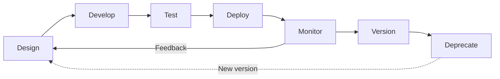

## Definition
#definition

The API Lifecycle encompasses the complete journey of an API from initial design through development, testing, deployment, versioning, and eventual deprecation. It is the structured process by which organizations treat APIs as products with their own roadmaps, SLAs, and sunset plans. For PMs, understanding this lifecycle is essential because APIs are often the primary way a product delivers value to partners, developers, and internal teams.

## How It Works

- **Design phase**: The API is specified before code is written using tools like [[API-Documentation]] (OpenAPI/Swagger). Stakeholders agree on resource models, endpoints, [[API-Authentication]] methods, and error handling. This is where a PM defines what the API's "jobs to be done" are.

- **Development & testing**: Backend teams implement the spec using [[Backend-Languages]] and frameworks. Automated contract tests validate that the implementation matches the spec. Mock servers let frontend and partner teams integrate in parallel.

- **Deployment & monitoring**: The API goes live behind an API gateway that handles [[Rate-Limiting]], authentication, and routing. [[Monitoring]] tools track latency, error rates (4xx/5xx), and usage patterns. [[CI-CD]] pipelines automate deployments.

- **Versioning & evolution**: As product requirements change, new [[API-Versioning]] strategies (URL path, headers, query params) allow the API to evolve without breaking existing consumers. This is where [[Technical-Debt]] management becomes critical.

- **Deprecation & sunset**: Older versions are announced for sunset with clear timelines (typically 6-12 months). Migration guides help consumers move to newer versions. The API is eventually decommissioned.

## PM Implications
#pm-implication

- **APIs are products**: PMs must own the API roadmap just as they own a user-facing feature roadmap. Each lifecycle stage has stakeholders, timelines, and success metrics. Treating APIs as internal plumbing leads to inconsistent design and poor developer adoption.

- **Breaking changes are costly**: Every breaking change in an API forces every consumer to update their integration. PMs must weigh the cost of maintaining backward compatibility (increased [[Technical-Debt]]) against the cost of forcing migrations on partners and customers.

- **Deprecation requires communication**: Sunsetting an API version is a product decision with customer impact. PMs must plan deprecation timelines, create migration guides, and coordinate with partner teams -- especially when those partners are revenue-generating (e.g., marketplace sellers on Flipkart's API).

- **Gateway metrics inform product decisions**: API usage data from the [[Monitoring]] layer (which endpoints are called most, by whom, error rates) is direct product analytics. PMs can use this data to prioritize improvements and identify unused features for removal.

## Example

**Google Maps Platform API lifecycle (India context)**: When Google deprecated its free-tier Maps API in 2018 and moved to a pay-per-use model, it followed a textbook API lifecycle transition. Indian startups like Dunzo, Swiggy, and Ola that heavily relied on the Maps API for route optimization and delivery tracking had to evaluate costs and consider alternatives like MapMyIndia (now MapmyIndia/Mappls). Google provided a 12-month deprecation window, migration documentation, and pricing calculators. PMs at these companies had to decide whether to absorb the new costs, negotiate enterprise pricing, or invest engineering effort in migrating to alternatives -- a classic [[Build-vs-Buy]] decision triggered by an API lifecycle event.

## Related Concepts

- [[REST-API]]
- [[API-Versioning]]
- [[API-Documentation]]
- [[Rate-Limiting]]
- [[Monitoring]]
- [[Session-04-APIs-Integrations]]
