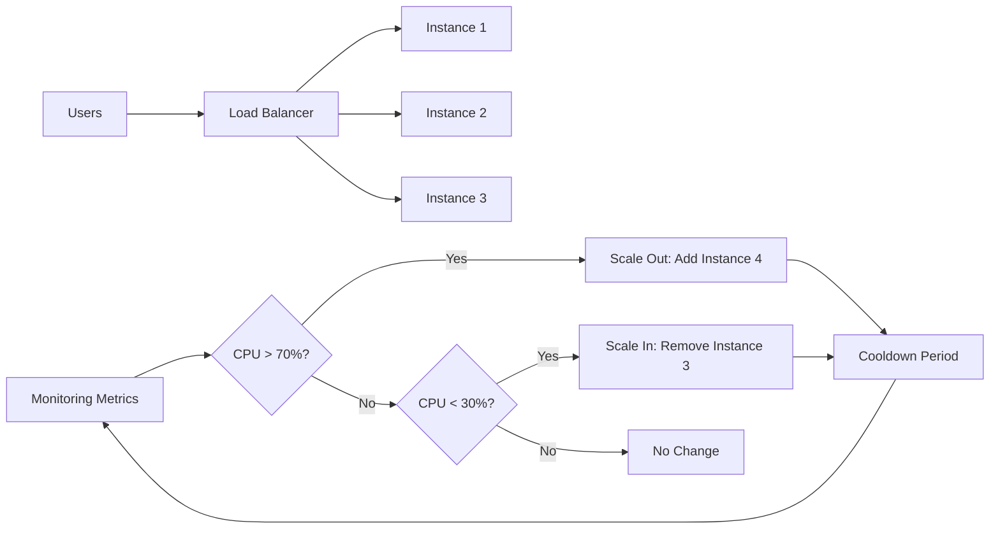

## Definition
#definition

**Auto-Scaling** is the ability of a [[Cloud-Computing]] system to automatically adjust compute resources (servers, containers, functions) based on real-time demand. When traffic spikes, the system adds capacity; when traffic drops, it removes capacity to reduce costs. For PMs, auto-scaling is the mechanism that lets your product handle viral moments, flash sales, or seasonal surges without pre-provisioning expensive infrastructure or risking downtime.

## How It Works

- **Scaling Triggers**: Auto-scaling rules are based on metrics like CPU utilization, memory usage, request count, or custom metrics from [[Monitoring]] tools. For example: "Add 2 servers when average CPU exceeds 70% for 5 minutes."
- **Horizontal vs. Vertical**: Horizontal scaling (scaling out) adds more instances of the same size. Vertical scaling (scaling up) increases the size of existing instances. Auto-scaling almost always refers to horizontal scaling because it avoids single-point-of-failure risks and doesn't require downtime.
- **Cooldown Periods**: After scaling up, the system waits a cooldown period (e.g., 5 minutes) before evaluating again, preventing rapid oscillation ("thrashing") between adding and removing instances.
- **Provider Implementations**: [[AWS]] Auto Scaling Groups, [[Azure]] Virtual Machine Scale Sets, and [[GCP]] Managed Instance Groups all implement this pattern. [[Serverless-Computing]] platforms like AWS Lambda auto-scale to zero -- you pay nothing when there's no traffic.
- **Load Balancer Integration**: Auto-scaling works hand-in-hand with load balancers that distribute incoming traffic across healthy instances. New instances are registered with the load balancer automatically and receive traffic only after passing health checks.

## PM Implications
#pm-implication

- **Cost vs. Reliability Trade-off**: Aggressive scaling (low thresholds, fast response) ensures reliability but increases [[Cloud-Billing]] costs. Conservative scaling saves money but risks slowdowns during sudden spikes. PMs must define acceptable latency targets to help engineering set the right thresholds.
- **Launch & Event Planning**: Before a marketing campaign, product launch, or sale event, PMs should coordinate with engineering to pre-scale (set minimum instance counts higher) rather than relying solely on reactive auto-scaling, which has a lag of 2-5 minutes. See [[Session-10-Cloud-Going-Live]].
- **Architecture Requirements**: Auto-scaling only works with stateless applications where any instance can handle any request. If your app stores session data locally, scaling out breaks user sessions. This drives architectural decisions toward [[State-Management]] solutions like [[Redis]] for session storage.
- **Monitoring Dependency**: Auto-scaling is only as good as the [[Monitoring]] metrics it watches. PMs should ensure that the right business metrics (not just CPU) are tracked -- e.g., "scale when API response time exceeds 500ms" is more user-centric than "scale when CPU hits 80%."

## Example

**Zomato During IPL Season**: During IPL cricket matches, Zomato sees massive order spikes during innings breaks and match endings. Their infrastructure, running on [[AWS]], uses Auto Scaling Groups configured to monitor both request-per-second metrics and API latency. When orders surge from a baseline of 5,000/minute to 25,000/minute during a match break, auto-scaling adds application server instances within 3 minutes. The PM works with engineering to set a minimum fleet size during IPL season (pre-scaling) and defines the acceptable order placement latency (under 2 seconds) that determines scaling thresholds. After the match, instances scale back down over 30 minutes, optimizing [[Cloud-Billing|cloud costs]].

## Related Concepts

- [[Cloud-Computing]] -- foundational platform enabling auto-scaling
- [[AWS]] -- AWS Auto Scaling Groups implementation
- [[Azure]] -- Azure VM Scale Sets implementation
- [[GCP]] -- GCP Managed Instance Groups
- [[Monitoring]] -- metrics that drive scaling decisions
- [[Serverless-Computing]] -- automatic scaling to zero
- [[Cloud-Billing]] -- cost implications of scaling policies
- [[Session-10-Cloud-Going-Live]] -- scaling strategies for production launches
