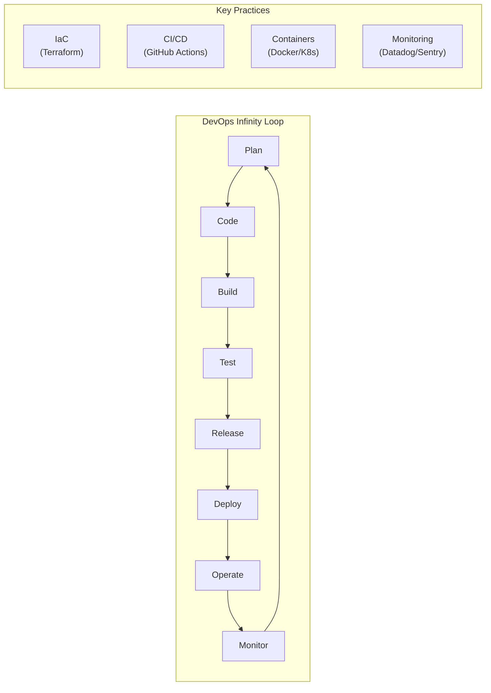

## Definition
#definition

DevOps is a set of cultural practices, organizational philosophies, and technical tools that unify software development (Dev) and IT operations (Ops) to shorten the development lifecycle and deliver features, fixes, and updates more frequently and reliably. It is not a single tool or role but a way of working that emphasizes automation, continuous feedback, shared responsibility for production systems, and breaking down silos between teams that build software and teams that run it. For PMs, DevOps maturity directly determines how fast product changes reach users.

## How It Works

- **Continuous Integration / Continuous Deployment ([[CI-CD]])**: The technical backbone of DevOps. Developers merge code to a shared branch frequently (CI), and every merge triggers automated builds, tests, and (in CD) deployments. This replaces the traditional model of monthly release cycles with continuous delivery -- changes can reach production within minutes of merging.

- **Infrastructure as Code (IaC)**: Tools like Terraform, Ansible, and CloudFormation define infrastructure (servers, databases, networks, load balancers) in version-controlled code rather than manual console configurations. This makes environments reproducible, auditable, and reviewable via [[GitHub]] pull requests. IaC reduces "works on my machine" and "works in staging but not production" problems.

- **[[Monitoring]] and observability**: DevOps requires comprehensive visibility into production systems. The "three pillars of observability" are metrics (Prometheus, Datadog), logs (ELK stack, Splunk), and traces (Jaeger, Zipkin). [[Error-Tracking]] tools like Sentry complement these. The goal is mean-time-to-detection (MTTD) measured in minutes, not hours.

- **[[Deployment-Pipeline]] strategies**: DevOps practices include deployment strategies that reduce risk: blue-green deployments (two identical environments, switch traffic instantly), canary releases (roll out to 1% of users, monitor, then expand), and [[Feature-Flags]] (decouple deployment from release). These strategies let PMs ship features to subsets of users and roll back without code changes.

- **Site Reliability Engineering (SRE)**: Pioneered by Google, SRE is DevOps applied with a software engineering mindset. SRE teams define Service Level Objectives (SLOs), maintain error budgets (if the system is more reliable than the SLO, spend the excess budget on feature velocity), and automate operational toil. PMs interact with SRE when negotiating reliability vs. feature tradeoffs.

## PM Implications
#pm-implication

- **Deployment frequency is a product capability**: A team deploying once a month cannot respond to market feedback or competitor moves quickly. PMs should champion DevOps maturity (measured by the DORA metrics: deployment frequency, lead time for changes, change failure rate, mean time to recovery) as a strategic investment, not just an engineering preference.

- **Feature flags change the PM-engineering contract**: With [[Feature-Flags]] and a mature [[CI-CD]] pipeline, the decision of "when to ship to users" shifts from engineering (tied to release cycles) to product (a toggle in LaunchDarkly or Flagsmith). This empowers PMs to control rollout timing, run A/B tests, and decouple marketing launches from code deployments.

- **On-call culture affects team health**: DevOps mandates that the team building the software also supports it in production ("you build it, you run it"). PMs must ensure on-call rotations are sustainable, incidents are blameless, and recurring operational issues are prioritized in the backlog. Ignoring on-call burden leads to engineer burnout and attrition.

- **DevOps investment has diminishing returns**: The first DevOps improvements (automated testing, basic CI/CD, [[Monitoring]]) yield dramatic returns. Later optimizations (full GitOps, service mesh, advanced canary analysis) have progressively smaller payoffs. PMs must help engineering prioritize DevOps investments by tying them to business outcomes (e.g., "reducing deployment lead time from 2 days to 2 hours means we can fix critical sale-day bugs in time").

## Example

**Razorpay's DevOps transformation (India context)**: Razorpay, India's leading payment gateway, processes transactions for millions of businesses and must maintain near-perfect uptime (their SLO is 99.99%). Their DevOps journey illustrates the practices at scale. Early on, Razorpay deployed weekly and relied on manual QA. As they scaled to processing 500M+ transactions per month, they invested heavily in DevOps: [[CI-CD]] pipelines using [[GitHub]] Actions and internal tools run 2,000+ automated tests on every PR. Infrastructure is managed via Terraform (IaC), enabling them to spin up identical environments for testing [[Microservices-Architecture]] interactions. They use canary deployments via their [[Deployment-Pipeline]] -- a new payment processing feature rolls out to 1% of traffic first, and automated [[Monitoring]] checks error rates and latency before expanding. Their [[Error-Tracking]] setup (Sentry + custom dashboards) alerts the on-call engineer within 60 seconds of a payment failure spike. The PM-relevant outcome: Razorpay now deploys 50+ times per day (up from once per week), and their change failure rate is below 2%. This velocity allows PMs to ship features like "Instant Settlements" and "Payment Links" in rapid iterations, getting merchant feedback within days rather than months. Their DevOps maturity is a genuine competitive advantage over legacy payment processors.

## Related Concepts

- [[CI-CD]]
- [[Deployment-Pipeline]]
- [[Feature-Flags]]
- [[Monitoring]]
- [[Microservices-Architecture]]
- [[Session-04-APIs-Integrations]]
