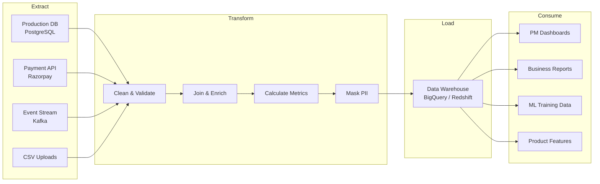

## Definition
#definition

**ETL (Extract, Transform, Load)** is a data integration process that pulls data from source systems (Extract), converts it into a usable format (Transform), and stores it in a destination like a data warehouse (Load). A modern variant, **ELT**, loads raw data first and transforms it inside the warehouse, leveraging the warehouse's compute power. For PMs, ETL pipelines are the invisible machinery that powers analytics dashboards, business reports, ML training datasets, and any product feature that needs data from multiple sources combined and cleaned.

## How It Works

- **Extract**: Data is pulled from source systems -- production databases ([[PostgreSQL]], MongoDB), third-party APIs (Stripe payments, Google Analytics, Salesforce), event streams (Kafka, Kinesis), flat files (CSV uploads), and application logs. Extraction can be full (dump everything) or incremental (only new/changed records since last run), with incremental being strongly preferred for performance.
- **Transform**: Raw data is cleaned, validated, enriched, and restructured. Examples: converting timestamps to a standard timezone, joining user data with transaction data, calculating derived metrics (7-day rolling average revenue), deduplicating records, masking PII fields, and applying business rules ("a transaction is 'completed' only if payment_status=success AND delivery_status=delivered").
- **Load**: Transformed data lands in the destination -- typically a data warehouse (BigQuery on [[GCP]], Redshift on [[AWS]], Snowflake, Azure Synapse on [[Azure]]). From there, BI tools (Looker, Metabase, Tableau) and [[Analytics-Instrumentation|analytics platforms]] query it for dashboards and reports.
- **Orchestration Tools**: Apache Airflow (the industry standard, open-source), Prefect, Dagster, and dbt (for the transform layer in ELT) manage pipeline scheduling, dependencies, retries, and monitoring. Managed services like Fivetran and Airbyte handle the Extract and Load steps, letting teams focus on Transform logic.
- **Pipeline Scheduling**: ETL jobs run on schedules -- hourly, daily, or near-real-time. A daily pipeline might run at 2 AM, processing the previous day's data. Near-real-time pipelines process data every 5-15 minutes using streaming frameworks. The PM's reporting requirements determine the schedule.

## PM Implications
#pm-implication

- **Data Freshness Expectations**: PMs must define how fresh data needs to be. "I want real-time revenue numbers" requires a streaming pipeline (expensive, complex). "I need yesterday's revenue by 9 AM" needs a daily batch pipeline (simpler, cheaper). Over-specifying freshness wastes engineering effort; under-specifying means decisions are made on stale data. Discuss latency requirements explicitly with the data team.
- **Data Quality Ownership**: ETL pipelines are where data quality is enforced or lost. If the Transform step doesn't handle nulls, duplicates, or format inconsistencies, every downstream dashboard and ML model is wrong. PMs should push for data validation rules ("order amount must be positive," "user_id must exist in users table") built into the pipeline, not discovered in a quarterly business review.
- **Cross-Functional Data Dependencies**: ETL pipelines often combine data from multiple teams' systems. A customer lifetime value (CLTV) metric might need data from the payments team's database, the support team's Zendesk, and the marketing team's attribution data. The PM must coordinate data access, schema agreements, and pipeline timelines across these teams.
- **Pipeline Failures & Monitoring**: ETL pipelines break -- source APIs change, data formats shift, volume spikes cause timeouts. PMs should understand their pipeline's [[Monitoring]] setup and SLA. "The revenue dashboard was wrong this morning because the payment pipeline failed at 3 AM and nobody noticed until 11 AM" is a PM-level problem that requires alerting and on-call processes.

## Example

**Meesho's Seller Analytics Pipeline**: Meesho, India's social commerce platform, runs a daily ETL pipeline that powers their seller dashboard. **Extract**: Data is pulled from the orders [[PostgreSQL]] database (order details, returns, cancellations), the logistics partner's API (delivery status, delivery time), and the payments system (settlement amounts, commission deductions). **Transform**: An Apache Airflow DAG orchestrates 15 transformation steps -- joining orders with delivery data, calculating seller-level metrics (order fulfillment rate, return rate, average delivery time), computing the 30-day rolling revenue, and flagging sellers whose return rate exceeds 15% for quality review. PII (customer names, addresses) is masked at this stage. **Load**: Transformed data lands in BigQuery, where Looker dashboards serve 500,000+ sellers their daily performance metrics. The PM owns the metric definitions (what counts as a "successful delivery"? when does the return window close?) and works with the data team to ensure the pipeline runs by 7 AM IST daily, before sellers check their dashboards. When the logistics API changed its response format and broke the pipeline for 2 days, the PM added a pipeline health check to their morning standup ritual.

## Related Concepts

- [[Data-Pipelines]] -- the broader concept of moving data through systems
- [[Analytics-Instrumentation]] -- collecting the events that ETL processes
- [[SQL-Basics]] -- the language used in Transform steps and warehouse queries
- [[PostgreSQL]] -- a common source database for ETL extraction
- [[GCP]] -- BigQuery as a destination warehouse
- [[AWS]] -- Redshift and Glue for ETL on AWS
- [[Monitoring]] -- pipeline health monitoring and alerting
