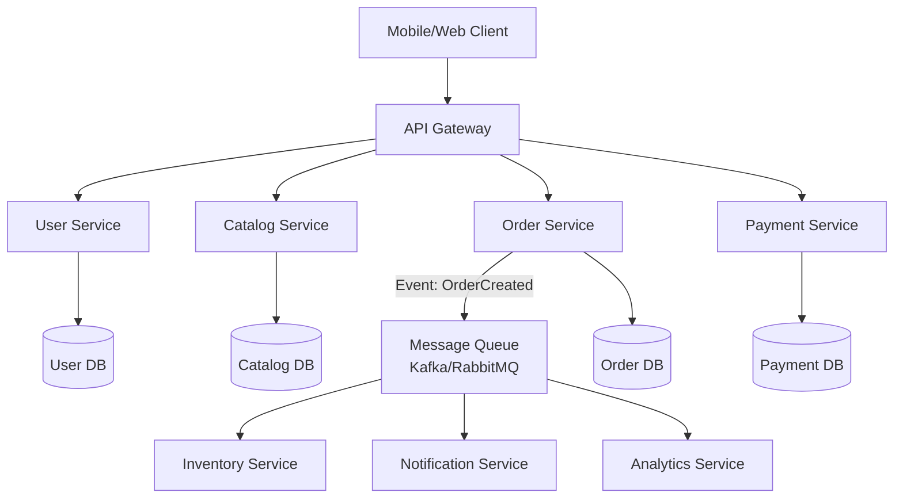

## Definition
#definition

Microservices Architecture is a software design approach where an application is built as a collection of small, independently deployable services, each responsible for a specific business capability. Unlike a monolithic architecture where all functionality lives in a single codebase, microservices communicate over the network via [[REST-API]] calls, message queues, or gRPC. Each service can be developed, deployed, and scaled independently, using different [[Backend-Languages]] and databases as appropriate -- at the cost of significantly increased operational complexity.

## How It Works

- **Service decomposition**: A monolithic application (e.g., an e-commerce platform with user management, catalog, cart, payments, and notifications in one codebase) is decomposed into independent services along business domain boundaries. Each microservice owns its data store (the "database per service" pattern), preventing tight coupling at the data layer and enabling independent [[Database-Scaling]].

- **Inter-service communication**: Services communicate via synchronous calls ([[REST-API]], gRPC) for real-time requests or asynchronous messaging (Kafka, RabbitMQ, SQS) for event-driven workflows. For example, when an order is placed, the Order Service publishes an "OrderCreated" event that the Inventory Service, Payment Service, and Notification Service each consume independently.

- **API Gateway**: A single entry point (e.g., Kong, AWS API Gateway, Nginx) routes external client requests to the appropriate microservice, handles [[API-Authentication]], applies [[Rate-Limiting]], and aggregates responses. This prevents clients from needing to know the internal service topology and is a critical component in the [[Client-Server-Architecture]].

- **Containerization and orchestration**: Microservices are typically packaged as Docker containers and orchestrated by Kubernetes, which handles deployment, scaling, service discovery, and self-healing. Without container orchestration, managing dozens of services across environments becomes operationally untenable.

- **Observability requirements**: With requests flowing across multiple services, debugging becomes exponentially harder. Distributed tracing (Jaeger, Zipkin), centralized logging (ELK stack), and [[Monitoring]] (Prometheus/Grafana) are not optional add-ons but critical infrastructure. [[Error-Tracking]] tools must correlate errors across service boundaries.

## PM Implications
#pm-implication

- **Team autonomy enables velocity**: Microservices allow teams to own and deploy their services independently. A payments team can ship a new UPI integration without waiting for the catalog team's release cycle. PMs benefit from this autonomy in sprint planning but must coordinate on cross-service features (e.g., a promotion that spans catalog, pricing, and checkout services).

- **Monolith-first is often the right start**: Premature microservices decomposition is a leading cause of startup failure due to over-engineering. PMs at early-stage companies should advocate for a well-structured monolith and migrate to microservices only when specific scaling, team size, or deployment frequency pressures demand it. The rule of thumb: fewer than 10 engineers usually means a monolith.

- **Operational costs are real**: Each microservice needs its own [[CI-CD]] pipeline, [[Monitoring]], alerting, error tracking, and on-call rotation. Moving from 1 monolith to 20 microservices can increase [[DevOps]] operational overhead by 5-10x. PMs must factor infrastructure and platform team costs into the microservices migration business case.

- **Data consistency becomes a product concern**: In a monolith, a single database transaction ensures consistency (e.g., deduct inventory AND charge payment atomically). In microservices, achieving consistency across services requires distributed patterns (saga, eventual consistency) that can result in temporary inconsistencies users might see. PMs must define acceptable consistency guarantees for each user-facing flow.

## Example

**Flipkart's microservices migration (India context)**: Flipkart's journey from monolith to microservices is one of India's most referenced architecture case studies. Their original monolithic Java application could not scale to handle Big Billion Days traffic (100M+ users in 24 hours). The migration decomposed the monolith into 150+ microservices: separate services for search, product catalog, cart, checkout, payments (integrating UPI, wallets, cards via [[API-Authentication]]), inventory, logistics, and seller management. Each service runs on Kubernetes clusters and communicates via a mix of REST and Kafka events. The PM-relevant outcome: during Big Billion Days, the catalog and search services scale to 10x normal capacity while the returns service stays at baseline -- impossible with a monolith where scaling one feature meant scaling everything. However, Flipkart also learned painful lessons: a bug in the inventory service once allowed overselling because the Order Service and Inventory Service had eventual consistency (the saga pattern had a race condition under extreme load). The PM had to define a business rule that inventory checks would use a "pessimistic reservation" pattern during sale events, trading some throughput for correctness -- a product decision driven by microservices architecture constraints.

## Related Concepts

- [[Client-Server-Architecture]]
- [[DevOps]]
- [[Database-Scaling]]
- [[Serverless-Computing]]
- [[Design-Patterns]]
- [[Session-04-APIs-Integrations]]
