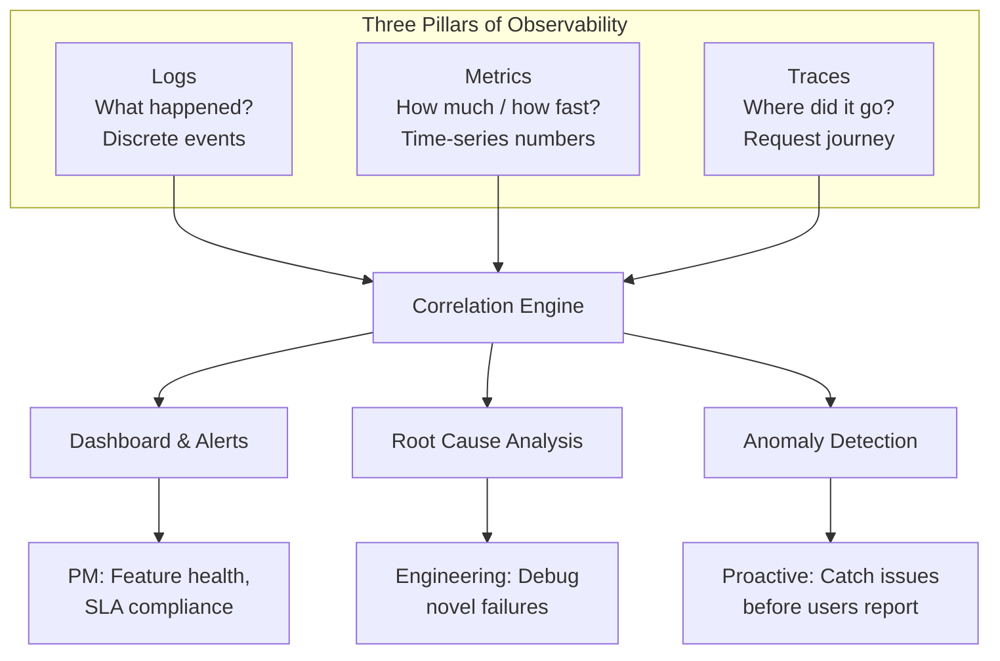

## Definition
#definition

**Observability** is the ability to understand a system's internal state by examining its external outputs. While [[Monitoring]] tells you *when* something is wrong (via predefined alerts), observability helps you understand *why* it is wrong -- even for novel failures you never anticipated. Observability rests on three pillars: **logs** (discrete event records), **metrics** (numeric measurements over time), and **traces** (request journey maps across services). For PMs, observability is the difference between "our checkout is slow" and "checkout is slow because the payment service's database query takes 3 seconds when the cart has more than 10 items."

## How It Works

- **Logs**: Timestamped records of discrete events -- "User 12345 placed order at 14:23:05", "Payment API returned 500 at 14:23:06". Logs are the most detailed telemetry but generate massive volumes. Tools: ELK Stack (Elasticsearch, Logstash, Kibana), Splunk, Datadog Logs, [[AWS]] CloudWatch Logs. Structured logging (JSON format) makes logs searchable and parseable.
- **Metrics**: Numeric time-series data aggregated over intervals -- request count, p95 latency, error percentage, CPU utilization. Metrics are compact (a single number per time interval) and excellent for dashboards and alerts. Tools: Prometheus + Grafana, Datadog, [[AWS]] CloudWatch Metrics, StatsD.
- **Traces (Distributed Tracing)**: A trace follows a single user request as it travels through multiple services -- API gateway to auth service to product service to payment service to database. Each hop is a "span" with timing data. Traces reveal bottlenecks in microservice architectures. Tools: Jaeger, Zipkin, Datadog APM, AWS X-Ray, OpenTelemetry (the emerging standard).
- **Monitoring vs. Observability**: [[Monitoring]] is a subset of observability. Monitoring answers known questions ("Is CPU above 80%?"). Observability answers unknown questions ("Why did 3% of users in Mumbai experience checkout failures between 2-3 PM on Tuesday?"). You need all three pillars correlated to achieve true observability.
- **Correlation & Context**: Modern observability platforms correlate logs, metrics, and traces so you can click from a latency spike (metric) to the slow traces (traces) to the specific error message (log). This dramatically reduces mean time to resolution (MTTR) during [[Incident-Response|incidents]].

## PM Implications
#pm-implication

- **Faster Incident Resolution**: Products with good observability resolve incidents 5-10x faster. A PM whose team takes 4 hours to debug production issues (poor observability) versus 30 minutes (good observability) ships features faster because engineers spend less time firefighting. This directly impacts roadmap velocity.
- **Feature-Level Instrumentation**: PMs should advocate for business-level observability -- not just "is the server healthy" but "are users completing the onboarding flow." Custom metrics like `onboarding_step_completion_rate` and traces through the onboarding funnel let PMs diagnose conversion drops with the same rigor engineers debug server errors. See [[Analytics-Instrumentation]].
- **Observability as a Feature Investment**: Implementing proper observability (structured logging, distributed tracing, custom dashboards) takes engineering time -- typically 1-2 sprints for a new service. PMs must prioritize this work alongside feature development, especially before [[Session-10-Cloud-Going-Live|going live]] with critical services.
- **Tool Selection & Cost**: Observability tools range from free (Prometheus + Grafana + Jaeger, self-hosted) to expensive (Datadog at $23/host/month for full observability). At scale, observability costs can reach 5-10% of total [[Cloud-Billing|cloud spend]]. PMs should understand these trade-offs during budget discussions.

## Example

**Zerodha's Trading Platform Observability**: Zerodha, India's largest stock broker, handles millions of orders during market hours (9:15 AM - 3:30 PM IST). Their observability stack uses the three pillars: **Metrics** (Prometheus + Grafana) track order throughput, API latency by endpoint, and system resource usage across their Go-based backend. **Logs** (structured JSON to ELK) capture every order event -- placement, modification, execution, rejection -- with user ID, instrument, and timestamp. **Traces** (custom implementation) follow an order from the user's app through the order management system, risk engine, and exchange gateway. When a PM notices that "order rejection rate for options trades spiked to 8% at 2:30 PM," the trace reveals that the risk engine's margin check was timing out because the exchange's real-time margin API was slow. The PM uses this data to justify building a local margin cache -- a product decision informed by observability data.

## Related Concepts

- [[Monitoring]] -- the foundational practice observability builds upon
- [[DevOps]] -- observability as a DevOps culture pillar
- [[Incident-Response]] -- observability reduces MTTR
- [[Analytics-Instrumentation]] -- business-level observability
- [[Uptime]] -- SLAs enforced through observability data
- [[Session-10-Cloud-Going-Live]] -- observability setup before production launch
