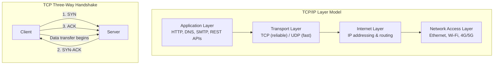

## Definition
#definition

TCP/IP (Transmission Control Protocol / Internet Protocol) is the foundational protocol suite that powers the internet. TCP handles reliable, ordered delivery of data between applications, while IP handles addressing and routing packets across networks. Every time a user loads a webpage, makes an [[REST-API]] call, or sends a message, TCP/IP is the transport layer making it happen beneath [[HTTP-Protocol]], [[DNS]], and every other application-layer protocol.

## How It Works

- **The four-layer model**: TCP/IP organizes network communication into four layers: Application (HTTP, SMTP, [[DNS]]), Transport (TCP, UDP), Internet (IP, routing), and Network Access (Ethernet, Wi-Fi). Each layer adds its own header to the data (encapsulation) and passes it down; the receiving side strips headers going up.

- **TCP's three-way handshake**: Before data flows, TCP establishes a connection using SYN, SYN-ACK, ACK messages. This handshake ensures both sides are ready, agree on sequence numbers, and can detect packet loss. This reliability makes TCP ideal for web traffic, API calls, and database queries but adds latency compared to UDP.

- **IP addressing and routing**: Every device on the internet has an IP address (IPv4 like `192.168.1.1` or IPv6 like `2001:0db8::1`). Routers use IP addresses to forward packets hop-by-hop across networks. [[DNS]] translates human-readable domain names to IP addresses so users do not need to memorize numbers.

- **TCP vs. UDP**: TCP guarantees delivery, order, and error-checking -- essential for [[REST-API]] calls, web pages, and email. UDP skips the handshake and reliability mechanisms for lower latency -- used in video streaming, online gaming, and real-time communications (WebRTC). PMs building real-time features must understand this tradeoff.

- **TLS over TCP**: Secure connections ([[HTTP-Protocol]] as HTTPS) add a TLS handshake on top of TCP, adding another round-trip before data transfer. Modern protocols like HTTP/2 and HTTP/3 (which uses QUIC over UDP) reduce this overhead, directly impacting page load times and API response latency.

## PM Implications
#pm-implication

- **Latency budgets start at TCP**: Every network request includes TCP handshake time (1 round-trip) plus TLS handshake (1-2 more round-trips). PMs setting performance SLAs (e.g., "API response under 200ms") must account for these fixed costs. Using [[CDN]] nodes closer to users reduces round-trip distance and thus TCP latency.

- **Protocol choice affects product capabilities**: If a PM's product requires real-time features (live location tracking, collaborative editing, push notifications), the engineering team may choose WebSockets (persistent TCP) or UDP-based protocols. Understanding TCP vs. UDP helps PMs evaluate feasibility and latency tradeoffs for real-time features.

- **Network conditions vary wildly in emerging markets**: In India, users on Jio 4G in rural areas experience 100-300ms latency per TCP round-trip, compared to 10-30ms on urban broadband. PMs targeting these users must factor in TCP overhead when designing features. Reducing the number of sequential API calls (and thus TCP handshakes) via [[GraphQL]] batching can materially improve user experience.

- **HTTP/3 and QUIC are changing the game**: The shift from TCP-based HTTP/2 to UDP-based HTTP/3 (QUIC) eliminates head-of-line blocking and reduces connection setup time. PMs should understand that adopting HTTP/3 via [[CDN]] providers like Cloudflare can improve performance without application code changes.

## Example

**UPI payment latency and TCP/IP (India context)**: India's Unified Payments Interface (UPI) processes over 10 billion transactions per month. Each UPI payment involves multiple TCP connections: the user's banking app to NPCI's switch, NPCI to the remitter bank, NPCI to the beneficiary bank, and back. Each TCP handshake adds latency. During peak hours (salary days, festival sales on Flipkart/Amazon), the cumulative TCP overhead across these hops contributes to transaction timeouts. NPCI addressed this by mandating persistent TCP connections (connection pooling) between banks and the NPCI switch, reducing per-transaction handshake overhead. PMs at fintech companies like PhonePe and Google Pay track TCP-level latency metrics as part of their transaction success rate [[Monitoring]], because a few hundred milliseconds of TCP delay can push a payment past its timeout window and result in a failed transaction.

## Related Concepts

- [[HTTP-Protocol]]
- [[DNS]]
- [[CDN]]
- [[REST-API]]
- [[Cloud-Computing]]
- [[Session-04-APIs-Integrations]]
